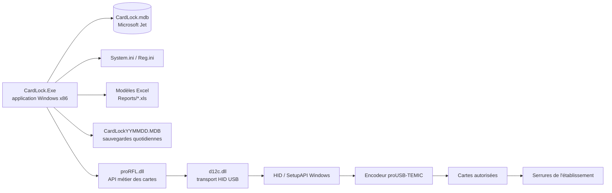

# ProUSB Card Lock — reconstruction dossier Windows

Date de l'analyse : 2026-11-12  
Périmètre : installation existante, sauvegardes et documentation fournie.  
But : documenter une réécriture Windows maintenable qui couvre les mêmes
fonctions métier et, lorsque l'organisation possède les droits, émet des
cartes compatibles avec **son** matériel et ses serrures existantes.

> Important — ce document ne contient ni clé de carte, ni mot de passe de
> base, ni trame USB, ni procédure de contournement de serrure. La
> compatibilité avec les cartes historiques doit passer par le matériel déjà
> autorisé et l'API du fournisseur, pas par la duplication du chiffrement ou
> le rejeu de commandes.

## 1. Résultat en une page

L'installation analysée est une application de bureau Windows locale et
offline-first, pas une application web ni un service cloud identifié. Son
exécutable principal est un PE x86 (`CardLock.Exe`), ses données sont dans une
base Microsoft Jet/Access protégée par mot de passe (`CardLock.mdb`) et
l'encodeur connecté est un périphérique HID USB `proUSB-TEMIC`.

Le chemin technique observé est le suivant :



Une réécriture doit donc préserver quatre propriétés :

1. fonctionnement local sans réseau ;
2. modèles hôtel / immeuble / chambre / séjour / carte / opérateur ;
3. sauvegarde et restauration fiables ;
4. un adaptateur matériel isolé qui utilise l'interface légitime de
   l'encodeur pour les cartes legacy.

La réimplémentation du protocole HID ou des mécanismes cryptographiques legacy
ne constitue pas un prérequis raisonnable ni sûr. Les DLL fournies exposent
déjà l'API fonctionnelle nécessaire ; elles doivent être utilisées sous licence
dans un petit pont x86 séparé.

## 2. Éléments examinés et preuve

| Élément | Observation | Preuve / limite |
|---|---|---|
| Exécutable | `CardLock.Exe`, PE Windows x86, 4 165 632 octets | SHA-256 `06965B8AE63576C2EDE293C24454EF792068F4E0A62B0D01DE1166D1FED9FDC1` ; inventaire REA `ev_c311c69a63be38b04eec8d3a25b6167a98dae6b49db0060ab735c96bc69ba53b` |
| Base active | `CardLock.mdb`, format Jet confirmé par l'en-tête `Standard Jet DB` | SHA-256 `215282CB644AF3505E8E9F24B50FB4F499A1CFF9250D6110CCDA5DF328D480A1` |
| Sauvegardes | huit `.MDB`, mêmes tailles mais huit empreintes différentes | elles sont de vrais points de restauration distincts, pas des doublons |
| Lecteur | `proUSB-TEMIC`, HID USB standard | Windows : VID `9915`, PID `1116`, révision `0120`, pilote Microsoft `input.inf` |
| Documentation | manuel logiciel, procédure de récupération, guide de configuration, vidéo | les trois PDF ont été lus ; la vidéo n'a pas été exécutée/analyse image par image |
| Analyse REA | inventaire d'artefact réussi ; le MCP a confirmé un PE natif x86 sans CLR et a ouvert le binaire dans Ghidra ; configuration Codex REA ajoutée avec sauvegarde de la config | les commandes CLI approfondies ont échoué et une large trace Ghidra MCP n'a pas répondu avant annulation ; ce n'est pas une preuve d'absence de code |

Les fichiers de configuration contiennent des identifiants de lecteur, des
codes d'enregistrement et des données propres à l'établissement. Ils ont été
utilisés pour corroborer l'architecture, mais sont volontairement masqués ici.

## 3. Composants logiciels observés

| Fichier | Rôle établi | Éléments observés |
|---|---|---|
| `CardLock.Exe` | interface, workflows métier et persistance | application GUI x86 ; requêtes SQL Access ; imports `proRFL.DLL`, `D12C.DLL`, `Mwic_32.DLL` |
| `proRFL.dll` | API métier de l'encodeur | exports : `GuestCard`, `FloorCard`, `BuildingCard`, `MasterCard`, `EmergencyCard`, `GroupCard`, `CheckOutCard`, `RecordCard`, `RoomSetCard`, `TimeSetCard`, `CardErase`, `ReadCard`, `ReadRecord`, `ReadE2`, `initializeUSB`, etc. |
| `d12c.dll` | transport USB moderne de l'encodeur | exports `IniUsbPro`, `readPortPro`, `writePortPro` ; imports Windows HID et SetupAPI |
| `d12.dll` | transport USB antérieur / alternatif | exports `IniUsb`, `readPorta`, `readPortb`, `writePorta`, `writePortb` |
| `Mwic_32.dll` | primitives de lecture/écriture de plusieurs familles de cartes | exports de lecture/écriture EEPROM et `DES_Encrypt` / `DES_Decrypt` ; ne pas reproduire les clés ou formats |
| `Reports/*.xls` | modèles d'export | `ReportCards.xls`, `ReportGuests.xls`, `ReportOpen.xls` |
| `skins/*.skn` | thèmes de l'interface | cinq thèmes distribués |

`CardLock.Exe` dépend aussi de MFC/Visual C++ 6 de débogage (`MFC42D.DLL`,
`MSVCRTD.DLL`). C'est un signal fort d'une application native ancienne ; ce
n'est pas une dépendance à reprendre dans le nouveau produit.

Un exécutable tiers `accesspv.exe` (outil de récupération de mot de passe
Access) est présent dans le dossier d'installation. Il **n'a pas été exécuté**.
Il ne doit pas faire partie de la nouvelle solution : demander au propriétaire
autorisé le mot de passe ou un export de la base est la voie correcte.

## 4. Architecture et workflow observés

### 4.1 Démarrage et configuration

1. l'application charge les paramètres locaux (`System.ini` et `Reg.ini`) ;
2. elle ouvre `CardLock.mdb` dans son dossier d'installation ;
3. elle charge l'état système, les opérateurs et la hiérarchie hôtel ;
4. elle initialise la pile encodeur ;
5. elle présente l'écran de connexion et les modules métier.

Le manuel décrit un compte administrateur par défaut sans mot de passe sur une
installation neuve. Ce comportement est un héritage à **ne pas reproduire** :
la nouvelle application doit exiger la création d'un premier administrateur et
un mot de passe robuste.

Les options observées incluent le nom d'hôtel, les heures de départ normale et
VIP, les options de serrure, le thème, le dossier de sauvegarde et les
paramètres de l'enregistrement de l'encodeur.

### 4.2 Paramétrage hôtel

Le logiciel gère :

- immeubles (`BuildingInfo`) ;
- étages et chambres (`RoomInfo`) ;
- ajout de chambres individuel ou en lot ;
- type de chambre, prix, tarif horaire, nombre maximal de cartes, état,
  remarque et portes communes ;
- options générales de serrure et de départ ;
- opérateurs, mots de passe et droits.

Le manuel confirme aussi les fonctions de configuration système, de
configuration d'immeuble/chambre, de regroupement de serrures et de réglage
d'horloge.

### 4.3 Réception et séjour

Les libellés et requêtes embarqués établissent les flux suivants :

1. sélectionner une chambre ou rechercher une chambre ;
2. enregistrer un client individuel ou un groupe ;
3. renseigner arrivée, départ, identité, prix, dépôt et remarque ;
4. émettre/associer une carte client ;
5. prolonger, changer de chambre, annuler une réservation ou effectuer un
   départ avec ou sans carte ;
6. basculer le statut de chambre (vacant, à nettoyer, etc.).

Les valeurs numériques exactes des statuts `Flag` et `Status` ne sont pas
établies par cette analyse. Elles doivent être découvertes par un export
autorisé de la base, puis être remplacées dans la nouvelle application par des
énumérations documentées.

### 4.4 Cartes et serrure

Le produit expose au minimum :

- cartes invité ;
- cartes d'étage, d'immeuble, maître et urgence ;
- cartes de groupe et de réglage de groupe ;
- cartes de départ, de réglage d'heure et de réglage de chambre ;
- carte de collecte d'événements, carte de réinitialisation et effacement de
  carte ;
- signalement de perte / mise sur liste noire d'après le manuel.

Le manuel décrit aussi les opérations d'autorisation système, d'affectation
d'une serrure à une chambre, de synchronisation d'horloge et de collecte de
journaux. Ce sont des **exigences fonctionnelles** ; les séquences radio,
cryptographiques et les secrets qui les rendent possibles restent hors de ce
document.

### 4.5 Rapports et événements

Les ressources et les requêtes attestent trois familles d'exports : cartes,
clients et ouvertures. La table `RecordOpen` stocke les enregistrements de
lecture de serrure, et la table `CardInfo` stocke les données et l'état des
cartes émises. Le nouveau produit doit exporter vers `.xlsx` ou CSV et garder
un journal d'audit immuable en plus de ces rapports utilisateur.

### 4.6 Sauvegarde et récupération

La documentation fournisseur indique une sauvegarde quotidienne nommée
`CardLockYYMMDD.MDB` dans le dossier défini par `DBBakPath`. Les fichiers
fournis suivent ce modèle (`CardLock260611.MDB` à `CardLock261104.MDB`).

La restauration legacy décrite par le fournisseur consiste à fermer le
logiciel, choisir une sauvegarde, lui donner le nom `CardLock.MDB`, puis la
remplacer dans le dossier du logiciel. Pour une opération réelle :

1. travailler sur une copie et conserver les empreintes SHA-256 ;
2. ne jamais remplacer la base active sans sauvegarde supplémentaire ;
3. vérifier l'ouverture et les totaux dans une copie isolée ;
4. consigner qui a validé la restauration.

La nouvelle application doit faire mieux : copie atomique, manifeste
d'empreintes, rétention configurée, test de restauration et journal d'audit.

## 5. Schéma Access réellement référencé par le code

Le mot de passe de la base n'a pas été recherché. Une ouverture OLE DB de la
dernière sauvegarde en mode lecture a échoué avec « mot de passe non valide »,
ce qui confirme la protection. Les noms ci-dessous viennent néanmoins des
requêtes SQL embarquées, donc ils ne sont pas déduits des manuels.

| Table | Colonnes observées | Rôle reconstruit |
|---|---|---|
| `BuildingInfo` | `BldNo`, `BldName` | immeubles |
| `RoomInfo` | `BldNo`, `FlrNo`, `RomID`, `RomID2`, `RoomNo`, `sType`, `Status`, `Price`, `Dai`, `CardCount`, `MaxCards`, `PublicDoor`, `BeiZhu`, `ReservCkIn`, `FirstCkOut`, `HourRateStartup`, `HourRatePrice` | inventaire et état des chambres |
| `GuestInfo` | `ID`, `BldRoomNo`, `Name`, `Sex`, `CType`, `CNo`, `ComeTime`, `GoTime`, `CardID`, `Flag`, `BeiZhu`, `Price`, `YaJin` | séjour, identité déclarée, prix et dépôt |
| `CardInfo` | `ID`, `CardData`, `Holder`, `Operator`, `BeiZhu`, `Status` | émission, titulaire et état de carte |
| `OperatorInfo` | `GongHao`, `Name`, `MiMa`, `QuanXian`, `BeiZhu` | utilisateurs, mot de passe et droits |
| `RecordOpen` | `OrderFlag`, `RecData`, `OpenTime` | événements lus depuis les serrures |
| `Dai` | `CardType`, `Dai` | paramètre associé à un type de carte ; sémantique exacte à confirmer |
| `systeminfo` | `ID` observé ; autres champs inconnus | configuration globale |

Le binaire comporte aussi une insertion de paramètres d'enregistrement avec
les champs `PPDL`, `dlsCoID`, `MachineID`, `HotelName`, `IPAddr`, `RoomNumMDB`,
`SN`, `UpdateTime` et `Remark`. La table cible n'est pas établie par la chaîne
statique observée.

Quatre migrations `RoomInfo` sont explicitement présentes : ajout de
`FirstCkOut`, `HourRatePrice`, `HourRateStartUp` et `ReservCkIn`. Une migration
doit donc être versionnée et idempotente dans la réécriture.

## 6. Encodeur USB et identifiant `5012…`

### Faits observés

- Windows identifie le périphérique connecté comme **proUSB-TEMIC**.
- Son identité Plug-and-Play est `USB\\VID_9915&PID_1116`, révision `0120`.
- Il est présenté comme HID standard, sur `Port_#0001.Hub_#0003`, avec le
  pilote Microsoft signé `input.inf` ; il n'y a pas de pilote fournisseur à
  installer.
- L'identifiant d'instance Windows est de la forme `READER_…`, différent de
  `5012…`.
- `d12c.dll` importe `HidD_GetHidGuid`, `HidD_GetAttributes`,
  `HidD_GetPreparsedData`, `HidP_GetCaps` et les fonctions SetupAPI
  d'énumération d'interface.
- `proRFL.dll` fournit `initializeUSB`, `ReadE2`, `DirectReadUSB`,
  `DirectWriteUSB`, `ReadCard` et les fonctions métier de cartes.
- La configuration legacy contient une trace d'enregistrement dont une valeur
  historique commence par `5012…`; elle est distincte de l'instance PnP.

### Chaîne déduite avec confiance moyenne

```text
CardLock.Exe
  -> proRFL.initializeUSB / ReadE2 (API métier et mémoire lecteur)
  -> d12c.IniUsbPro / readPortPro / writePortPro (transport)
  -> SetupAPI + HID.DLL (découverte de l'interface HID)
  -> proUSB-TEMIC
```

Il est donc probable que `5012…` soit un numéro applicatif lu dans la mémoire
ou l'état interne de l'encodeur puis persisté dans l'état d'enregistrement, et
non un VID/PID ou le numéro de série PnP Windows. La signification exacte, le
format des octets et le point d'appel exact restent **non prouvés**.

Pour confirmer ce dernier point de façon légitime, il faut soit la documentation
du fournisseur, soit une trace contrôlée de démarrage/lecture réalisée sur un
poste de test autorisé, sans carte sur le lecteur et sans commande d'écriture.
Il ne faut pas renifler/rejouer des commandes de programmation de serrure.

## 7. Spécification de la réécriture Windows

### 7.1 Choix de référence

Construire une application desktop **.NET 8 x64, WPF**, avec un petit
processus compagnon **x86** pour les DLL legacy. WPF est adapté aux écrans de
réception denses, à l'impression/export, au travail hors ligne et aux dialogues
matériels. Le processus x86 évite de lier le produit moderne aux contraintes
32 bits de `proRFL.dll` et `d12c.dll`.

```text
CardLock.Desktop (WPF x64)
  ├─ CardLock.Application       cas d'usage et transactions
  ├─ CardLock.Domain            règles métier et enums documentés
  ├─ CardLock.Infrastructure    SQLite, sauvegarde, rapports, audit
  ├─ CardLock.Legacy.Contracts  contrats IPC sans secrets
  └─ CardLock.Legacy.Bridge x86 adaptateur autorisé proRFL/d12c
```

Le bridge ne reçoit que des requêtes métier validées ; il ne publie aucune clé,
aucun buffer brut ni commande HID. Un canal local authentifié (named pipe avec
ACL utilisateur/service) est suffisant.

### 7.2 Domaines et cas d'usage

| Domaine | Cas d'usage indispensables |
|---|---|
| Identité et droits | premier administrateur, connexion, changement de mot de passe, droits par rôle, audit |
| Hôtel | paramètres, immeubles, étages, chambres, portes communes |
| Réservation | individuel, groupe, réservation, annulation, arrivée, prolongation, changement de chambre, départ |
| Cartes | demande d'émission, renouvellement, remplacement, lecture, effacement, perte, statut et traçabilité |
| Serrures | configuration système/heure/chambre/groupe via l'adaptateur autorisé |
| Événements | import, normalisation, recherche, export et conservation des ouvertures |
| Rapports | cartes, clients, événements ; exports `.xlsx`, CSV et impression |
| Résilience | sauvegarde, restauration testée, import legacy, journal des opérations |

### 7.3 Flux d'émission compatible

Le nouveau logiciel peut créer les mêmes cartes **pour les serrures dont
l'organisation est propriétaire** en conservant le composant fournisseur
autorisé :

1. vérifier le rôle de l'opérateur, la chambre/serrure et les dates ;
2. créer une intention d'émission auditée mais non finalisée ;
3. demander au bridge x86 de vérifier qu'un encodeur enregistré et une carte
   appropriée sont présents ;
4. appeler l'opération métier autorisée de `proRFL.dll` correspondant au type
   de carte ;
5. relire la carte par l'API autorisée et comparer uniquement les métadonnées
   attendues ;
6. finaliser l'émission et l'état de séjour dans une transaction ;
7. stocker l'opérateur, l'heure, le motif et le résultat, jamais les secrets.

En cas d'échec de lecture/écriture, la demande reste échouée et l'utilisateur
voit une action de récupération ; aucune carte n'est affichée comme émise sur
la seule base d'un clic UI. Les tests physiques doivent se faire sur une serrure
de laboratoire autorisée, avec carte de test et journal.

### 7.4 Données et migration

- Base de production recommandée : SQLite chiffré ou SQLite avec chiffrement
  géré par l'OS/DPAPI, dans un dossier applicatif non partagé.
- Conserver l'ancienne `.mdb` intacte et l'importer seulement depuis une copie.
- Obtenir le mot de passe auprès du propriétaire/fournisseur ou un export CSV
  signé ; ne pas tenter de contourner la protection.
- Écrire un importeur transactionnel par table, avec mapping explicite des
  statuts legacy et rapport d'anomalies.
- Conserver les `CardData` legacy comme donnée sensible chiffrée au repos et
  restreinte aux opérations qui en ont besoin.
- Réconcilier les compteurs de cartes, chambres actives et enregistrements
  d'ouverture avant toute bascule.

### 7.5 Modèle de sauvegarde cible

Chaque sauvegarde doit :

1. être produite à partir d'un snapshot cohérent ;
2. être écrite dans un nouveau fichier puis renommée atomiquement ;
3. avoir un manifeste JSON avec SHA-256, version du schéma et heure UTC ;
4. être vérifiée par une restauration sur base temporaire ;
5. être soumise à une politique de rétention et éventuellement une copie hors
   poste chiffrée.

Conserver un export legacy optionnel `CardLockYYMMDD.MDB` uniquement tant que
les anciennes installations doivent être servies ; il ne remplace pas la
sauvegarde moderne.

## 8. Plan de réalisation

| Phase | Livrable | Critère de sortie |
|---|---|---|
| 0. Cadrage | licence DLL/matériel, propriétaire des serrures, mot de passe/export MDB autorisé | autorisation écrite et jeu de test isolé |
| 1. Données | schéma versionné, importeur en lecture seule, rapport de migration | totaux et échantillons validés avec l'ancien logiciel |
| 2. Métier | chambres, réception, opérateurs, rapports et audit | tests unitaires/intégration sur snapshots anonymisés |
| 3. Bridge matériel | IPC local + adaptateur x86 sur API fournisseur | détection encodeur et lecture non destructive validées |
| 4. Cartes | flux autorisés avec double contrôle et lecture de retour | essais sur serrure de laboratoire, journal complet |
| 5. Migration | sauvegarde, restauration, formation et pilote | restauration vérifiée et validation métier |

## 9. Points non établis et prochaines preuves nécessaires

| Question | État | Moyen sûr de réponse |
|---|---|---|
| Mot de passe et schéma complet MDB | non établi ; base protégée | mot de passe/export fourni par le propriétaire |
| Valeurs des enums de statut | partiellement établi | export autorisé + comparaison avec l'UI legacy |
| Format précis de `5012…` | inférence seulement | doc fournisseur ou trace de lecture contrôlée sans carte |
| Protocole HID et clés | volontairement hors périmètre | ne pas le reconstituer ; utiliser SDK/DLL autorisé |
| Backend réseau actif | non établi | aucun service/configuration/trace active observé |
| Décompilation native REA | le binaire s'ouvre dans Ghidra MCP, mais une large trace n'a pas répondu avant annulation | reprendre avec des requêtes très ciblées dans une session REA/Ghidra fraîche ; ne déduire aucune absence de code |
| Compatibilité sur vraie serrure | non testée | banc de test autorisé et procédure de validation |

## 10. Empreintes de sauvegarde

| Fichier | SHA-256 |
|---|---|
| `CardLock260611.MDB` | `BB4F8F6ACE4DB2360F21ED216F2C88FE494E258A228E560A797EEC7B485C270E` |
| `CardLock260713.MDB` | `A2918DF5F9E3A0CCB0F7E4D42A61EC3C2277117320EE5B7AB78077A380F033AA` |
| `CardLock260721.MDB` | `CDBEB2299F082A152CA55319B109F86458A20F6C658AB5712B83F39661A6ECEC` |
| `CardLock261025.MDB` | `EB3EA2EA28336F5BD4CF87860CDED9658FF5AC05DE5F80146800DD40EFD67068` |
| `CardLock261027.MDB` | `DD0FF97F11DAB00E4EF3EF565B8334C36A725B195E3F801566D13855FC3F529D` |
| `CardLock261030.MDB` | `B063F44E369474F078CE7F404A728C4B83260461A0A34829C541CA405232B7D5` |
| `CardLock261031.MDB` | `1CBC29B04D9947036AB3CF08F6F4F68547E88B8A71A02C43A808BB8CD365611D` |
| `CardLock261104.MDB` | `ACC7CA41EF0AE8ADB921862000DD96B834FBC3587A9C35D6B5C51E9A3BE7E3CC` |

## 11. Limites de cette analyse

- Aucune base, sauvegarde, carte ou serrure n'a été modifiée.
- Aucun mot de passe, clé, code d'enregistrement ou identifiant propre à
  l'établissement n'est reproduit dans ce dossier.
- Aucun logiciel n'a été démarré et aucune carte n'a été programmée.
- Les conclusions marquées « observé » viennent des binaires, fichiers,
  documentation ou PnP. Celles marquées comme probables sont des inférences
  explicitement bornées.
- La présence de dépendances réseau/MySQL dans un exécutable ne prouve pas un
  backend en production ; l'analyse n'a observé aucun backend actif.
