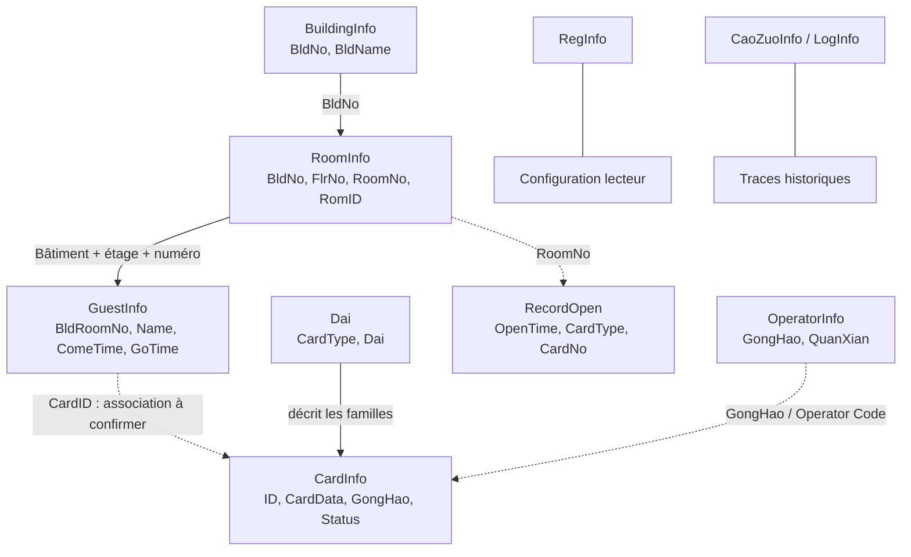

# Analyse de la base proUSB CardLock.mdb

## Périmètre
CardLock.mdb est une base Microsoft Access / Jet du logiciel proUSB Hotel Lock System. Le fichier fourni dans cette conversation (`CardLock(3).mdb`) fait 933 888 octets ; son SHA-256 est `215282cb644af3505e8e9f24b50fb4f499a1cff9250d6110ccda5df328d480a1`. Appointment PMS la lit sans modifier la base originale. Le parseur inventorie toutes les tables Access, y compris les objets système, leurs colonnes, le nombre de lignes et leur état de lecture. Les tables système sont étiquetées et ne sont jamais converties en données hôtelières.

Dix tables métier sont identifiées : `BuildingInfo`, `RoomInfo`, `GuestInfo`, `CardInfo`, `RecordOpen`, `Dai`, `RegInfo`, `OperatorInfo`, `CaoZuoInfo` et `LogInfo`. Les objets Access système (`MSys*`, formulaires, rapports, etc.) ne sont pas des entités hôtelières.

## Tables métier
| Table | Champs connus | Fonction |
|---|---|---|
| `BuildingInfo` | `BldNo`, `BldName` | Référentiel des bâtiments. |
| `RoomInfo` | `BldNo`, `FlrNo`, `RomID`, `RomID2`, `RoomNo`, `sType`, `Status`, `Price`, `Dai`, `CardCount`, `MaxCards`, `PublicDoor`, `BeiZhu`, `ReservCkIn`, `FirstCkOut`, `HourRateStartup`, `HourRatePrice`, `PersonsNum`, `RoomID` | Inventaire physique des chambres/portes. Source de vérité de l'inventaire PMS. |
| `GuestInfo` | `ID`, `BldRoomNo`, `Name`, `Sex`, `CType`, `CNo`, `ComeTime`, `GoTime`, `CardID`, `Flag`, `BeiZhu`, `Price`, `YaJin` | Clients et séjours historiques. |
| `CardInfo` | `ID`, `CardData`, `Holder`, `GongHao`, `BeiZhu`, `Status`, `CardID` | Registre des cartes émises ; `CardData` porte la trame de 16 octets et `GongHao` l'Operator Code. |
| `RecordOpen` | `OrderFlag`, `RecData`, `OpenTime`, `CardType`, `CardNo`, `RoomNo` | Journal des événements d'ouverture. |
| `Dai` | `CardType`, `Dai` | Dictionnaire des familles de cartes. |
| `RegInfo` | `Registor`, `RegDate` | Enregistrement du lecteur / logiciel. |
| `OperatorInfo` | `GongHao`, `Name`, `MiMa`, `QuanXian`, `BeiZhu` | Comptes et permissions historiques ; ne jamais importer `MiMa` comme mot de passe PMS. |
| `CaoZuoInfo` | Colonnes inventoriées à l'import | Table historique d'opérations ; sémantique détaillée non raccordée au modèle PMS. |
| `LogInfo` | Colonnes inventoriées à l'import | Table historique de journalisation ; sémantique détaillée non raccordée au modèle PMS. |

Les versions proUSB peuvent différer. Le centre de données affiche le nom de chaque table, son nombre de lignes, ses colonnes et un indicateur de table système Access. Si une table est vide, le parseur utilise les métadonnées de colonnes lorsqu'elles sont exposées par le lecteur MDB ; sinon la liste de colonnes peut être vide. Les colonnes documentées ci-dessus restent à confirmer sur le fichier exact si sa version diffère.

## Relations métier

Ces relations sont des liens métier observés ou déduits des champs ; elles ne garantissent pas l'existence de clés étrangères Access.

### Règles de jointure
1. `BuildingInfo.BldNo = RoomInfo.BldNo` rattache les chambres aux bâtiments. `BldNo = 0` et `FlrNo = 0` sont des identifiants valides ; seul le sentinelle interne `-1` signifie « non renseigné ».
2. Une chambre se résout au minimum par `BldNo + FlrNo + RoomNo`. Le numéro seul n'est pas globalement unique.
3. `GuestInfo.BldRoomNo` peut contenir `bâtiment-chambre` ou `bâtiment-étage-chambre`. Le fichier fourni contient notamment des références à trois segments comme `2-1-12064`, `1-1-12174`, `2-1-12074` et `1-3-3012`. En cas d'ambiguïté ou d'étage explicitement incompatible, ne pas deviner.
4. `CardInfo.CardData` décrit la carte physique ; `ID` et `GongHao` sont des métadonnées. Une carte n'est ni une chambre ni une réservation.
5. `RecordOpen` est un événement d'accès, pas un séjour.
6. `Dai` décrit les familles de cartes, pas les bâtiments ou les étages.

## Correspondance vers Appointment PMS
| Source | Entité PMS | Règle |
|---|---|---|
| `BuildingInfo` | `ResourceGroup` | Un groupe par bâtiment, même sans chambre. |
| `RoomInfo` | `ResourceItem` | Une ressource par ligne exploitable ; aucun numéro, étage ou tarif fictif. |
| `GuestInfo` | `TimelineBooking` | Séjour créé uniquement si la chambre exacte existe et si les dates sont valides. |
| `CardInfo` | Snapshot proUSB | Cartes émises, séparées de l'inventaire. |
| `RecordOpen` | Audit proUSB | Journal d'ouverture. |
| `Dai` | Dictionnaire de cartes | Décodage des familles. |
| `RegInfo`, `OperatorInfo`, `CaoZuoInfo`, `LogInfo` | Diagnostic historique | Pas de création de chambres ou de réservations. |

## Contrôles d'intégrité
- Comparer les lignes de `BuildingInfo` et `RoomInfo` avec les bâtiments et chambres convertis.
- Afficher le nombre de chambres par `BldNo` ; un bâtiment vide reste visible.
- Ignorer et signaler les lignes RoomInfo sans numéro exploitable.
- Ne jamais déduire `FlrNo` du premier chiffre de `RoomNo`.
- Préserver les identifiants zéro (`BldNo = 0`, `FlrNo = 0`) et ne les remplacer par les segments d'une référence composée que si les colonnes sources sont réellement absentes.
- Si `RoomNo` est vide, rechercher un identifiant legacy non vide dans `RomID2` puis `RomID` ; une colonne vide ne doit pas masquer un alias renseigné.
- Un statut `RoomInfo.Status` inconnu reste non renseigné : ne pas marquer automatiquement la chambre « propre ».
- Un prix vide reste à 0 / non renseigné ; aucun tarif par défaut.
- Un GuestInfo orphelin ou ambigu ne génère jamais de ressource.
- Un séjour sans dates valides ou avec départ non postérieur à l'arrivée est ignoré.
- Un nouvel import remplace les séjours précédemment importés, même sans séjour valide.
- Un import réel élimine les groupes de démonstration, mais conserve les groupes créés manuellement.
- Ne jamais importer les mots de passe opérateur historiques.

## Diagnostic du bâtiment manquant
1. Vérifier le chemin et la date de modification du CardLock.mdb sélectionné. Windows peut rediriger les écritures vers `%LOCALAPPDATA%\VirtualStore`.
2. Comparer le nombre de lignes de `BuildingInfo` et les valeurs distinctes de `RoomInfo.BldNo`.
3. Si BuildingInfo contient le bâtiment 2 mais RoomInfo aucune ligne avec `BldNo = 2`, afficher le bâtiment vide, sans inventer de chambres.
4. Contrôler également les valeurs `BldNo` 0 et `FlrNo` 0 ; elles doivent apparaître dans le bon groupe et ne doivent pas être classées « sans bâtiment ».
4. Si les lignes existent mais ne sont pas converties, inspecter `RoomNo`, `RomID`, `BldNo` et `FlrNo` dans le rapport.

Les colonnes de `CaoZuoInfo` et `LogInfo` sont inventoriées, mais leur sémantique complète doit être confirmée avant conversion ou synchronisation.
