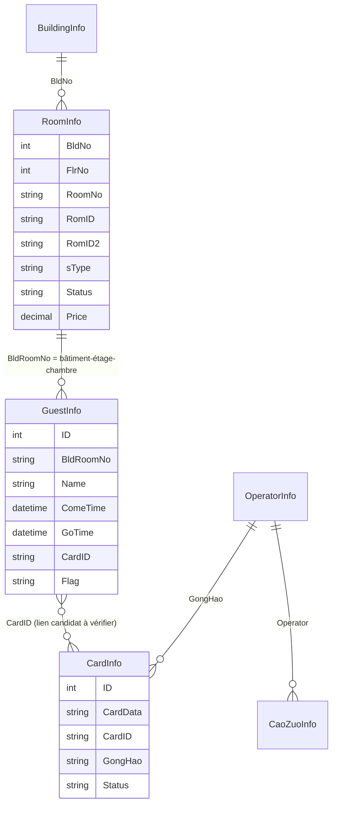

# Analyse de la base proUSB `CardLock.mdb`

## 1. Fichier examiné et niveau de preuve

Fichier fourni : `CardLock(3).mdb` (Microsoft Access / Jet, 933 888 octets, environ 912 Kio). La structure textuelle du fichier confirme les tables métier listées ci-dessous et plusieurs colonnes. L'application utilise `mdb-reader` pour lire les tables et le nouvel inventaire de l'écran **Base de données locale → Local & CardLock** affiche, pour le fichier réellement sélectionné, le nombre de lignes et les colonnes de chaque table.

**Important :** les noms de tables et les colonnes sont identifiables dans le fichier, mais les relations métier ne sont pas toutes déclarées comme clés étrangères Access. Les liens décrits ici sont des clés métier observées dans les champs et dans les références CardLock ; les champs dont le sens n'est pas démontré sont signalés comme tels. Ne pas traiter les tables système Access comme des tables PMS.

## 2. Tables métier

| Table | Rôle | Champs repérés / interprétation |
|---|---|---|
| `BuildingInfo` | Référentiel des bâtiments | `BldNo` identifiant du bâtiment ; `BldName` libellé. Le numéro 0 ne doit pas être interprété comme une valeur absente. |
| `RoomInfo` | Référentiel maître des chambres physiques | `BldNo`, `FlrNo`, `RomID`, `RomID2`, `RoomNo`, `sType`, `Status`, `Price`, `Dai`, `CardCount`, `MaxCards`, `PublicDoor`, `BeiZhu`, `ReservCkIn`, `FirstCkOut`, `HourRateStartup`, `HourRatePrice`, `PersonsNum`, `RoomID`. Cette table est la source de vérité pour créer les ressources du planning. |
| `GuestInfo` | Clients, séjours et affectation des cartes | `ID`, `BldRoomNo`, `Name`, `Sex`, `CType`, `CNo`, `ComeTime`, `GoTime`, `CardID`, `Flag`, `BeiZhu`, `Price`, `YaJin`. Une ligne de séjour ne prouve pas à elle seule qu'une chambre existe : la chambre doit être retrouvée dans `RoomInfo`. |
| `CardInfo` | Registre des cartes émises | `ID`, `CardData`, `Holder`, `GongHao`, `BeiZhu`, `Status`, `CardID`. `CardData` contient la trame de carte ; `ID` est l'identifiant de ligne DB, distinct des champs encodés dans la carte. |
| `RecordOpen` | Journal des ouvertures des serrures | Enregistrements d'audit. La structure interne doit être décodée séparément avant d'affirmer un lien exact avec une ligne de séjour ou une carte. |
| `OperatorInfo` | Comptes opérateurs proUSB | Champs visibles notamment `GongHao` et `Name`. Les secrets d'authentification ne sont pas importés dans Appointment. |
| `CaoZuoInfo` | Historique des opérations opérateur | Champs repérés : `Operator`, `Time`, `Work`. |
| `RegInfo` | Enregistrement/licence de l'installation proUSB | Champs repérés : `RegDate`, `Registor`, `RegisterCode`. Ce n'est pas le référentiel des bâtiments. |
| `LogInfo` | Journal technique / applicatif | Table conservée dans l'inventaire ; sémantique et colonnes détaillées à confirmer par les données réelles. |
| `Dai` | Table de référence utilisée par le modèle proUSB | Le nom apparaît aussi comme champ de `RoomInfo`. Son rôle exact (catégorie/tarif/autre) n'est pas suffisamment établi : ne pas le convertir arbitrairement en type de chambre ou en tarif. |

Le fichier contient également des objets et catalogues internes Access (par exemple `MSysObjects`, `MSysRelationships`, `MSysQueries`, `MSysACEs`, `MSysDb`, `MSysAccessObjects`). Ils décrivent la base Access et ne sont pas des entités d'hôtel à importer dans le PMS.

## 3. Relations métier

### Clés et cardinalités à respecter

1. **Bâtiment → chambres :** `BuildingInfo.BldNo` correspond à `RoomInfo.BldNo`. Plusieurs chambres appartiennent à un bâtiment.
2. **Chambre → séjours :** `GuestInfo.BldRoomNo` est une référence composite. Le fichier contient des valeurs de la forme `2-1-12064`, `1-1-12174`, `2-1-12074` et `1-3-3012` : bâtiment, étage, chambre. Il ne faut pas découper systématiquement cette valeur en seulement deux segments.
3. **Identité de chambre :** utiliser au minimum le triplet `(BldNo, FlrNo, RoomNo)` pour retrouver une chambre. Le numéro de chambre seul n'est pas unique entre bâtiments et peut être ambigu entre étages. `RomID`, `RomID2` et `RoomID` doivent être conservés comme identifiants legacy tant que leur sémantique exacte n'est pas prouvée.
4. **Séjour → carte :** `GuestInfo.CardID` et `CardInfo.CardID` constituent un lien métier candidat ; il faut vérifier les cardinalités et les copies de cartes avant de le considérer comme une relation 1:1.
5. **Opérateur → carte / actions :** `GongHao` et `Operator` fournissent les clés métier probables entre `OperatorInfo`, `CardInfo` et `CaoZuoInfo`.

## 4. Pourquoi l'ancien import pouvait perdre des chambres ou inventer des valeurs

L'audit du code d'import a révélé plusieurs défauts concrets :

- `BldNo = 0` et `FlrNo = 0` étaient traités comme des valeurs manquantes (`> 0` / `<= 0`). Le parseur pouvait donc déplacer une chambre ou la classer « sans bâtiment ».
- Une colonne `RoomNo` vide pouvait masquer une valeur exploitable dans `RomID2` ou `RomID`, car la première valeur non nulle était retenue même si elle était vide.
- Les séjours orphelins de `GuestInfo` pouvaient référencer un identifiant de ressource inexistant dans `RoomInfo`. Ils ne doivent jamais créer une chambre.
- Un tarif absent recevait une valeur arbitraire de 123 et un statut non reconnu était transformé en « propre ». Ces valeurs n'étaient pas issues de CardLock.
- L'import remplaçait certains enregistrements par ID mais pouvait conserver des séjours issus d'un ancien fichier MDB. Un nouvel import doit remplacer l'instantané CardLock complet.

## 5. Règles du nouvel import

- Lire et inventorier **toutes** les tables ; afficher nom, nombre de lignes, colonnes et état de lecture.
- Créer les bâtiments depuis `BuildingInfo`, puis compléter un bâtiment uniquement si un `BldNo` réel est référencé dans `RoomInfo`.
- Créer une chambre uniquement depuis une ligne `RoomInfo` contenant un numéro exploitable. Aucun intervalle, aucune numérotation supposée et aucune ligne `GuestInfo` ne peuvent générer une chambre.
- Préserver les identifiants 0 et les références composées à 2 ou 3 segments.
- Si une chambre n'a pas de bâtiment, la conserver dans un groupe d'anomalies « sans bâtiment identifié », sans l'attribuer arbitrairement.
- Si un séjour ne correspond pas sans ambiguïté à une chambre, le signaler et ne pas créer de ressource fictive.
- Ne pas inventer de prix, de statut housekeeping, de dates ou de type de chambre.
- Remplacer les données CardLock précédemment importées par le nouvel instantané ; conserver les ressources créées manuellement.

## 6. Vérification opérationnelle recommandée

1. Fermer proUSB avant de copier la base ; sous Windows, vérifier la copie VirtualStore si le logiciel a été installé dans `Program Files`.
2. Importer le fichier et ouvrir **Inventaire des tables CardLock**.
3. Vérifier que `BuildingInfo` et `RoomInfo` contiennent les deux bâtiments et leurs lignes de chambres.
4. Comparer les nombres de lignes `RoomInfo` par `BldNo` avec le nombre de ressources affichées dans chaque groupe du Gantt.
5. Vérifier les séjours `GuestInfo` avec leurs références à trois segments et les avertissements de séjours non rattachés.
6. Ne confirmer l'import qu'après contrôle des compteurs. Conserver le MDB source original en lecture seule.

**Limite actuelle de l'analyse :** le nombre de lignes par table et la liste complète des colonnes sont désormais calculés à partir du fichier sélectionné dans l'application. Les liens exacts des tables d'audit et de configuration (`RecordOpen`, `LogInfo`, `Dai`) restent à valider sur les enregistrements structurés ; aucun lien non démontré n'est présenté comme une clé étrangère certaine.
